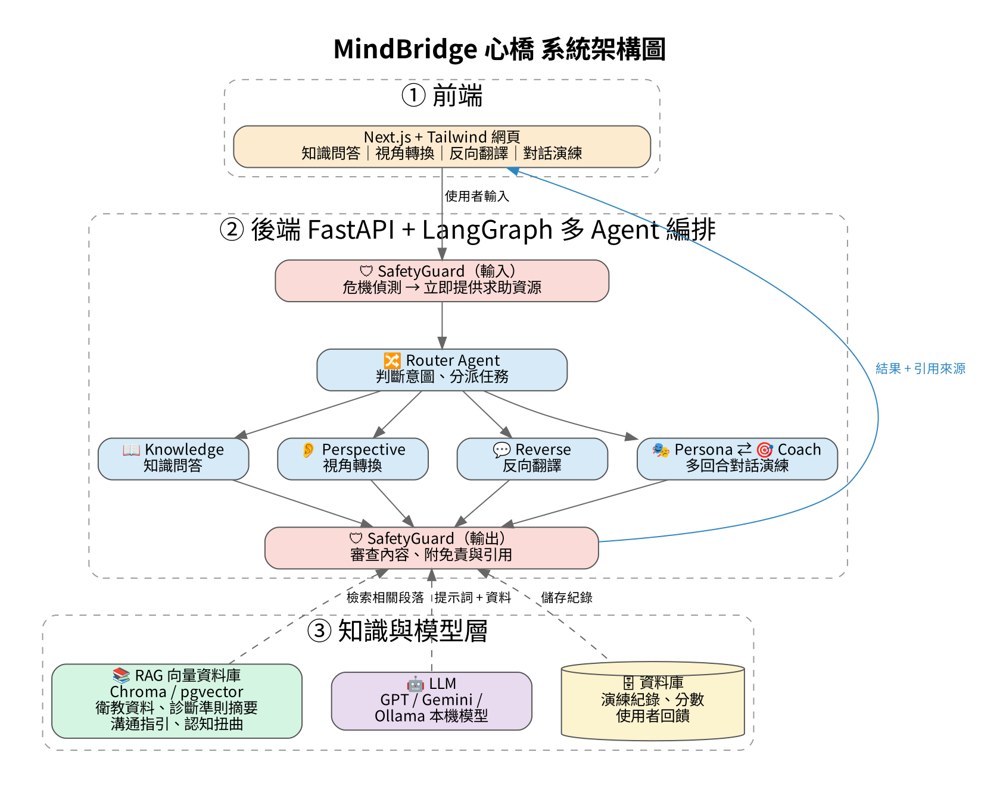

# MindBridge 心橋 — 精神疾病語言共感 Agent

> Bridge the words, reach the mind.　在被扭曲的語言之間，搭一座理解的橋。

生成式 AI 課程期末專案。完整專案發想請見 [docs/proposal.md](docs/proposal.md)。



## 功能
- 📖 **知識問答**：RAG 檢索衛教資料，回答並附出處
- 👂 **視角轉換**：一句話在患者耳中可能的樣子 + 認知機制解析 + 更好的說法
- 💬 **反向翻譯**：患者話語背後可能的感受與需要 + 建議回應
- 🎭 **對話演練**：Persona Agent 扮演角色、Coach Agent 每回合評分並產生報告
- 🛡 **SafetyGuard**：偵測危機訊號，中止模擬並提供求助資源


## 執行
```bash
pip install -r requirements.txt
python main.py                      # 沒設定 LLM 也能跑（示範模式）
```

## 接上 LLM（擇一）
```bash
# OpenAI
export LLM_API_KEY=sk-...  LLM_MODEL=gpt-4o-mini
# 本機 Ollama（免費）
ollama pull qwen2.5:7b
export LLM_BASE_URL=http://localhost:11434/v1  LLM_MODEL=qwen2.5:7b
# Google Gemini（OpenAI 相容端點）
export LLM_BASE_URL=https://generativelanguage.googleapis.com/v1beta/openai  LLM_API_KEY=...  LLM_MODEL=gemini-2.0-flash
```

## 檔案
- `knowledge/`：知識庫（Markdown，依「##」切塊）。內容為衛教摘要，正式版需改用並核對權威來源。
- `rag.py`：檢索（雛形用字元 bigram TF-IDF，正式版換 Embedding + 向量資料庫）
- `llm.py`：OpenAI 相容 API 呼叫
- `agents.py`：SafetyGuard / Router / Knowledge / Perspective / Reverse / Persona / Coach
- `main.py`：終端機介面
- `docs/`：專案發想與概念圖（`diagrams/*.dot` 為 Graphviz 原始檔）

> ⚠️ 本專案為心理衛生教育用途，不提供診斷或治療。如果你正感到痛苦，請撥打 1925 安心專線（24 小時）。
