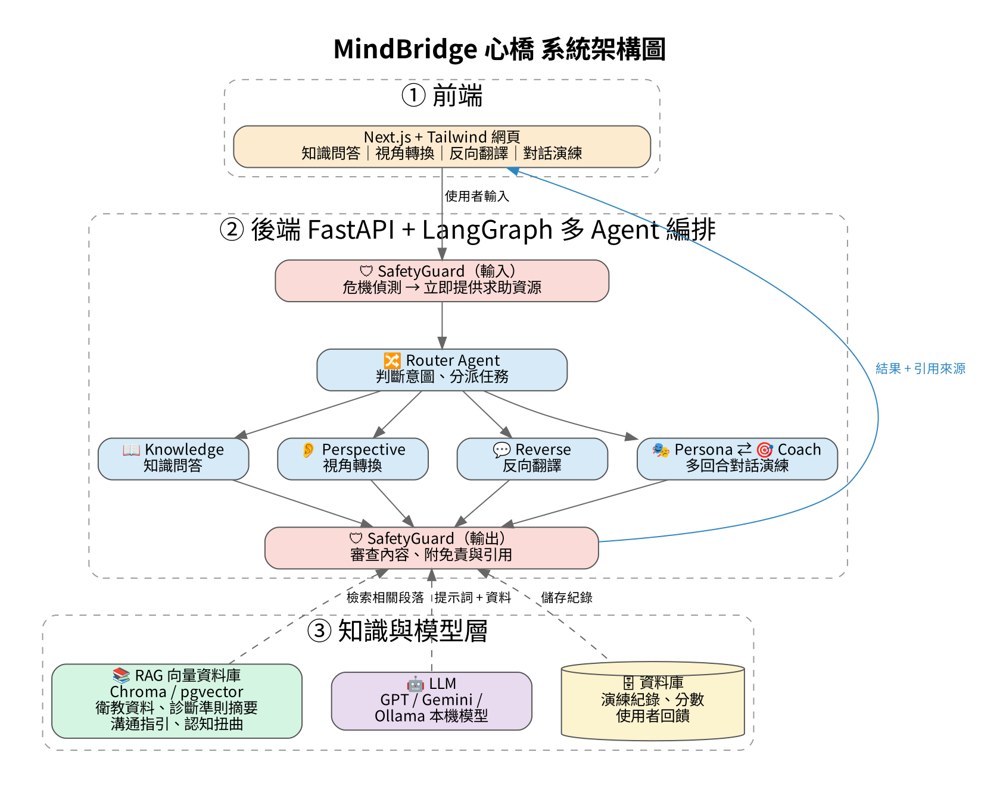
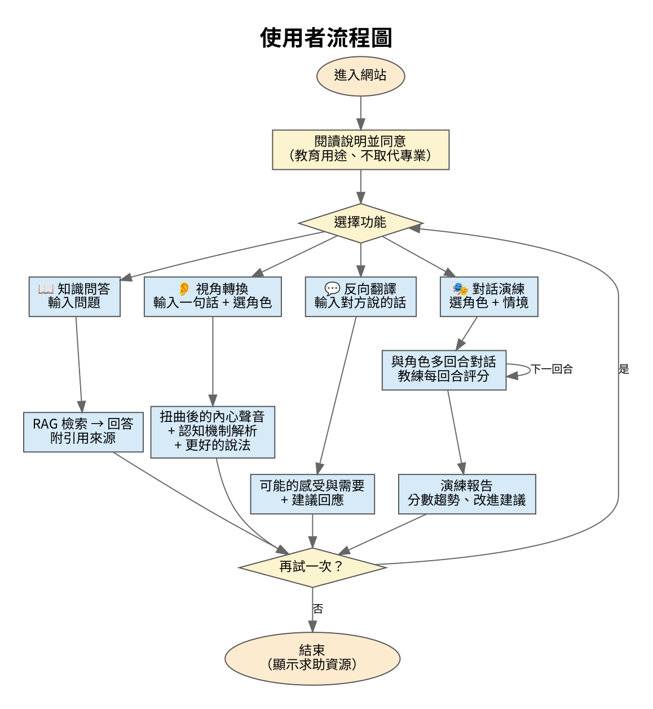
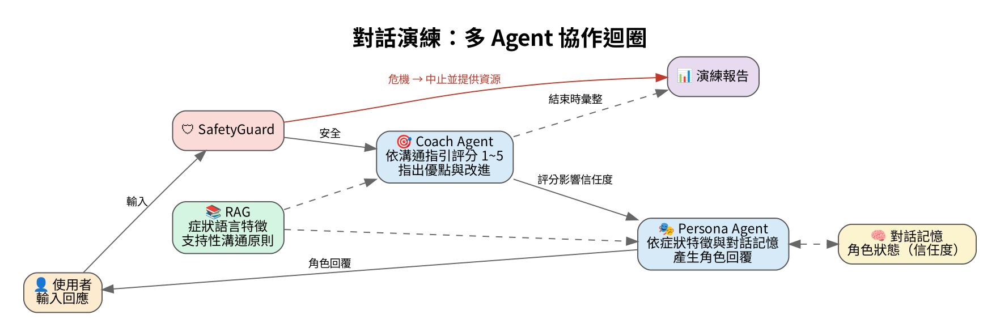

# 學號 系級 姓名　期末專案發想：MindBridge 心橋 — 精神疾病語言共感 Agent

> **"Bridge the words, reach the mind."　在被扭曲的語言之間，搭一座理解的橋。**

一句話介紹：一個結合 **RAG 知識檢索** 與 **多 Agent 協作** 的共感學習系統。它讓一般人「聽見」精神疾病患者可能如何接收一句話，看懂患者話語背後的感受，並透過和 AI 角色的多回合對話演練，學會用更支持性的方式溝通。

---

## 一、現有做法的不足

精神疾病患者常面臨「說的話不被理解、也容易誤解別人的話」的困境。目前常見的「AI 模擬患者」做法，有以下不足：

| 現有做法的問題 | MindBridge 的解法 |
|---|---|
| 只靠提示詞（Prompt）生成，沒有依據，容易流於刻板印象、加深汙名 | **RAG**：只根據衛教資料生成，每次附上引用來源 |
| 只給結果、沒有解釋，使用者不知道**為什麼**會這樣解讀 | 每次轉換都附上**認知機制解析**和更好的說法 |
| 單次轉換、無法互動，只能看不能練 | **多回合對話演練**，教練 Agent 即時評分與回饋 |
| 綁定單一雲端平台，串接成本高、失敗就無法使用 | **OpenAI 相容介面**，可切換雲端或本機模型 |
| 缺乏安全機制，沒有處理使用者本身可能處於危機的情況 | **SafetyGuard** 進出雙重把關，危機時提供求助資源 |

## 二、要解決的問題

- 一般人難以理解精神疾病患者的語言邏輯，導致誤解與疏離
- 患者常把善意的話解讀成敵意或嘲笑，造成關係衝突
- 家屬、朋友、輔導志工想幫忙，卻**不知道該怎麼說**，常說出「想開一點」這類讓對方更受傷的話
- 現有的同理訓練資源（VR 模擬、虛擬病人）多集中在醫療專業領域，一般大眾缺少可以互動、有依據的練習工具

## 三、目標使用者與情境

| 使用者 | 情境 |
|---|---|
| 大學生、一般民眾 | 朋友最近怪怪的，想知道怎麼關心比較好 |
| 患者家屬 | 想理解家人說的「我沒差」「不想麻煩你」背後的意思 |
| 輔導志工、心理系學生 | 在面對真人之前，先和 AI 角色練習溝通 |
| 國高中、大學心理衛生課程 | 作為課堂互動教材，降低對精神疾病的恐懼與汙名 |

## 四、功能設計（四大功能 + 安全守門）

### 1. 📖 知識問答（RAG）
例如問「妄想和幻覺差在哪？」，系統會從知識庫檢索相關段落，**只根據資料回答並標註出處**。資料裡沒有的內容就說不知道，避免 AI 亂編。

### 2. 👂 視角轉換
輸入一句話並選擇角色，系統輸出四項內容：
- **可能聽到的內心聲音**：「你一定覺得我自己做不到」
- **背後機制**：讀心術、個人化（認知扭曲）
- **為什麼會這樣解讀**：附知識庫引用
- **更容易被接收的說法**：「如果你需要，我隨時可以一起處理」

不只是體驗，而是「體驗 → 理解 → 學會怎麼說」。

### 3. 💬 反向翻譯
輸入對方說的話（例如「我沒差啦，都可以」），系統分析：可能的感受、可能的需要、應避免的回應、建議的回應。

### 4. 🎭 對話演練（多 Agent 協作）
選擇角色與情境（例如「期末分組，你一週沒回群組訊息，組員私訊你」），和 **Persona Agent** 進行多回合對話。**Coach Agent** 每回合依照支持性溝通原則評分（1～5 分），指出做得好的地方和改進建議。結束後產生**演練報告**（平均分數、進步趨勢）。

### 5. 🛡 SafetyGuard 安全守門（貫穿全部功能）
- **輸入端**：偵測「不想活」「傷害自己」等危機訊號，**立即中止模擬**，提供 1925 安心專線、1995 生命線、1980 張老師等資源
- **輸出端**：審查 AI 內容不得獵奇、醜化，也不得描寫自傷細節，並附上「模擬僅供理解，每位患者經驗不同」的提醒

## 五、系統架構

| 層級 | 內容 |
|---|---|
| ① 前端 | Next.js + Tailwind 網頁，四大功能頁面 |
| ② 後端 | FastAPI 提供 API，LangGraph 編排多個 Agent，進出都經過 SafetyGuard |
| ③ 知識與模型層 | RAG 向量資料庫、LLM（可切換雲端或本機模型）、紀錄資料庫 |

## 六、使用者流程

## 七、Agent 設計

| Agent | 職責 | 輸入 | 輸出 | 使用工具 |
|---|---|---|---|---|
| 🛡 SafetyGuard | 危機偵測、內容審查 | 使用者輸入 / AI 輸出 | 放行或中止 + 求助資源 | 關鍵字規則 + LLM 分類 |
| 🔀 Router | 判斷意圖並分派任務 | 自由輸入的文字 | 要交給哪個 Agent | LLM（JSON 輸出） |
| 📖 Knowledge | 知識問答 | 問題 | 回答 + 引用 | RAG 檢索 |
| 👂 Perspective | 視角轉換 | 一句話 + 角色 | 內心聲音、機制、解釋、建議說法 | RAG + LLM |
| 💬 Reverse | 反向翻譯 | 對方說的話 + 角色 | 感受、需要、建議回應 | RAG + LLM |
| 🎭 Persona | 扮演角色 | 對話紀錄 + 情境 | 角色回覆 | RAG + 對話記憶 |
| 🎯 Coach | 評分與回饋 | 角色的話 + 使用者回應 | 分數、優點、建議、報告 | RAG（溝通指引） |

對話演練的協作方式：

Coach 的評分會影響 Persona 的「信任度」：使用者回應得越支持，角色就越願意敞開心房，越被否定就越退縮。這樣使用者可以**直接感受到不同說法帶來的差異**。

## 八、RAG 設計

1. **資料來源**：衛福部心理健康衛教資料、DSM-5-TR 診斷準則摘要、NIMH 衛教資料、心理急救（PFA）溝通原則、認知行為治療的認知扭曲分類
2. **切塊**：依主題小節切塊，例如「核心特徵」「語言接收的特徵」「外在語言表現」「溝通建議」，每塊都保留來源標籤
3. **向量化與儲存**：Embedding 模型 → Chroma（開發）/ pgvector（部署）
4. **檢索**：依使用者輸入與選擇的角色，取出最相關的 3～4 段，並提高該疾病文件的權重
5. **生成**：把檢索到的段落放進提示詞，要求 LLM 只根據資料回答並用 [編號] 標註出處
6. **呈現**：每次回答都顯示「📚 依據」，讓使用者可以查證

## 九、使用技術

| 部分 | 技術 | 用途 |
|---|---|---|
| 前端 | Next.js、React、TypeScript、Tailwind CSS | 網頁介面 |
| 後端 | Python、FastAPI | API 服務 |
| Agent 編排 | LangGraph | 多 Agent 狀態流轉、對話記憶 |
| RAG | Embedding 模型、Chroma / pgvector | 知識檢索 |
| LLM | OpenAI 相容 API：GPT-4o-mini / Gemini / Ollama 本機模型 | 生成與判斷；可切換，不綁定單一平台 |
| 資料庫 | SQLite → PostgreSQL | 演練紀錄、分數、回饋 |
| 語音（進階） | Web Speech API / Whisper | 語音輸入演練 |
| 部署 | Docker、Cloud Run / Render | 上線展示 |

## 十、目前進度（已開始動工）

已完成**終端機版雛形**（Python），整條 Agent 流程可以實際執行：
- ✅ 知識庫：6 份文件，切成 25 個段落（4 種疾病、認知扭曲、支持性溝通原則）
- ✅ RAG 檢索：中文 bigram TF-IDF，不需額外套件即可運作，之後會換成 Embedding
- ✅ 七個 Agent：SafetyGuard、Router、Knowledge、Perspective、Reverse、Persona、Coach
- ✅ 四大功能和自由提問（Router 自動分派）都能運作
- ✅ 危機偵測：輸入危機字詞時中止模擬並顯示求助資源
- ✅ LLM 介面可接 OpenAI / Gemini / 本機 Ollama；未設定時自動進入示範模式

（插入：終端機執行截圖，建議放「知識問答」「視角轉換」「對話演練」各一張）

檢索測試結果：
| 測試輸入 | 第一名檢索結果 |
|---|---|
| 妄想和幻覺差在哪 | 思覺失調症 › 妄想與幻覺的差異 ✅ |
| 這件事我可以幫你（憂鬱症） | 憂鬱症 › 溝通建議 / 語言接收的特徵 ✅ |
| 老闆叫我等等去找他（焦慮症） | 廣泛性焦慮症 › 語言接收的特徵 ✅ |

## 十一、可行性評估

| 項目 | 狀態 | 說明 |
|---|---|---|
| Agent 流程 | ✅ 已驗證 | 雛形已可完整執行 |
| RAG 檢索 | ✅ 已驗證 | 雛形版檢索正確，正式版換 Embedding 只需替換一個模組 |
| LLM 串接 | ✅ 已驗證 | 使用 OpenAI 相容 API，已測試 JSON 解析與錯誤處理 |
| 知識庫內容 | ⚠️ 部分手動 | 先手動整理衛教資料摘要，之後逐條核對權威來源 |
| 網頁前端 | 🔜 待做 | 使用熟悉的 Next.js，風險低 |
| Coach 評分品質 | ⚠️ 需測試 | 準備 20 組「好／普通／不好」的回應，檢查評分是否合理 |

## 十二、倫理與安全設計

這個主題很敏感，所以安全是設計的一部分，不是事後才補上：
- **不醜化、不獵奇**：提示詞明確限制，每段模擬都附上「為什麼」的解釋與「每位患者經驗不同」的提醒
- **有依據**：用 RAG 限制 AI 只根據衛教資料生成，減少刻板印象
- **危機優先**：偵測到使用者本身可能有危機時，立即停止模擬並提供求助資源
- **不取代專業**：首頁同意條款說明本系統為教育用途，不提供診斷或治療
- **隱私**：可以選擇本機 Ollama 模型，對話內容不傳到外部

## 十三、成效評估方式

1. **RAG 正確率**：準備 30 題知識問題，檢查回答是否正確、引用是否對應
2. **Coach 評分一致性**：比對 Coach 分數與人工標註的「好／普通／不好」是否一致
3. **使用者測試**：邀請 5～10 位同學使用，前後各填一份簡短的同理心與溝通信心問卷，比較使用前後差異

## 十四、開發時程

| 時間 | 工作項目 |
|---|---|
| 11/16～11/22 | ✅ 完成終端機雛形（RAG + 7 個 Agent） |
| 11/23～11/29 | 改用 Embedding + Chroma；用 LangGraph 重構 Agent 流程；核對知識庫來源 |
| 11/30～12/06 | FastAPI 後端 + Next.js 前端四大功能頁面 |
| 12/07～12/13 | 對話演練加入信任度與演練報告；紀錄存資料庫 |
| 12/14～12/20 | 使用者測試、評估、調整提示詞與安全機制 |
| 12/21～Demo | 部署上線、準備展示與報告 |

## 十五、未來擴充

- 增加角色：自閉症類群障礙、創傷後壓力症候群（PTSD）
- 語音輸入與語音回覆，讓演練更接近真實對話
- 教師模式：課堂上可以出情境題，並查看全班的演練統計
